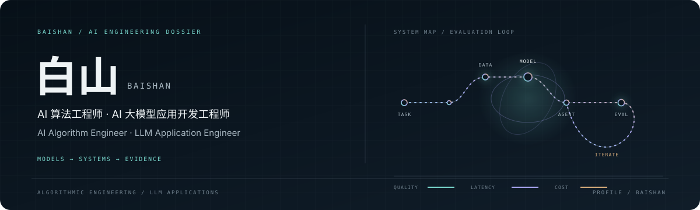
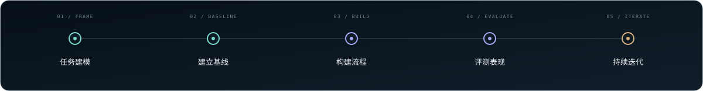

  <picture>
    <source media="(prefers-color-scheme: dark)" srcset="assets/hero-observatory-dark.svg" />
    <source media="(prefers-color-scheme: light)" srcset="assets/hero-observatory-light.svg" />
    
  </picture>

  <picture>
    <source media="(prefers-color-scheme: dark)" srcset="https://readme-typing-svg.demolab.com/?font=JetBrains+Mono&amp;size=16&amp;duration=3800&amp;pause=1200&amp;color=79D8CD&amp;center=true&amp;vCenter=true&amp;width=720&amp;height=34&amp;lines=Algorithms+%C3%97+LLM+Applications+%C3%97+Evaluation;From+Problem+Framing+to+Reliable+AI+Workflows" />
    <source media="(prefers-color-scheme: light)" srcset="https://readme-typing-svg.demolab.com/?font=JetBrains+Mono&amp;size=16&amp;duration=3800&amp;pause=1200&amp;color=147C76&amp;center=true&amp;vCenter=true&amp;width=720&amp;height=34&amp;lines=Algorithms+%C3%97+LLM+Applications+%C3%97+Evaluation;From+Problem+Framing+to+Reliable+AI+Workflows" />
    
  </picture>

  <strong>从任务建模，走向可评测、可持续迭代的 AI 应用。</strong> 
  <em>From problem framing to AI applications that are measurable and improvable.</em>

  <a href="mailto:baishanmumu@gmail.com">Email</a> ·
  <a href="https://github.com/baishanmumu?tab=repositories">Repositories</a> ·
  <a href="projects/agentlens/README.md">AgentLens concept</a>

---

### 01 / PROFILE · 个人定位

**中文** — 我专注于 AI 算法工程与大模型应用开发，连接任务建模、模型能力和实际应用。工作重点包括数据与模型方案、RAG/Agent 工作流、系统集成，以及用端到端评测推动持续改进。

**English** — I work across AI algorithm engineering and LLM application development, connecting problem formulation and model capabilities to practical applications. My focus includes data and model choices, RAG and agent workflows, system integration, and end-to-end evaluation for continuous improvement.

### 02 / CAPABILITY MAP · 能力版图

| **算法工程 / Algorithm Engineering** 任务与指标建模 · 数据和特征处理 · 训练与推理 · 误差分析 Task and metric design · data and features · training and inference · error analysis | **大模型应用 / LLM Applications** Prompt 与结构化输出 · RAG 检索 · Agent/工具调用 · 多步工作流 Prompting and structured output · RAG · agents and tools · multi-step workflows |
| :--- | :--- |
| **系统集成 / Systems** API 与数据链路 · 任务编排 · 日志追踪 · 异常处理 APIs and data pipelines · orchestration · tracing · failure handling | **评测优化 / Evaluation** 任务完成度 · 检索相关性 · 工具调用 · 质量/延迟/成本/可靠性 Task success · retrieval relevance · tool correctness · quality/latency/cost/reliability |

### 03 / TECHNOLOGY SYSTEM · 技术栈

           
           
        

*Click a badge to open the official website or documentation / 点击徽章直达对应技术的官网或官方文档*

### 04 / ENGINEERING LOOP · 工程闭环

  <picture>
    <source media="(prefers-color-scheme: dark)" srcset="assets/engineering-loop-dark.svg" />
    <source media="(prefers-color-scheme: light)" srcset="assets/engineering-loop-light.svg" />
    
  </picture>

**中文** — 按数据、模型、检索、工具和编排层定位问题，再结合任务完成度、答案依据、延迟、成本与稳定性决定下一步优化。

**English** — I locate failures across data, models, retrieval, tools, and orchestration, then use task success, grounding, latency, cost, and reliability to guide the next iteration.

### 05 / PROJECT CONCEPT · AgentLens 项目构想

**A reproducible evaluation and debugging workbench for tool-using LLM agents.**

为工具型 Agent 设计的可复现评测与调试工作台：记录运行轨迹，使用固定任务与模拟工具回放，并比较 Prompt/模型变化对任务完成、工具选择、参数正确性、答案依据、延迟与 token 成本的影响。

**Status:** Concept stage; no implementation or benchmark results are claimed yet. 
**状态：** 方案构想阶段，尚未声称已有实现或评测结果。

[Read the project blueprint / 查看项目蓝图](projects/agentlens/README.md)

### 06 / TECHNICAL REFERENCES · 技术参考

以下仓库是明确标注上游来源的 fork，仅作为技术阅读参考。 
The repositories below are forks, listed as technical references with their upstream maintainers credited.

| Project | Area | Upstream · My fork |
| :--- | :--- | :--- |
| **ARTEX** | Agent-driven security testing · Agent 自主安全测试 | [Upstream](https://github.com/archiveproject/ARTEX) · [Fork](https://github.com/baishanmumu/ARTEX) |
| **Cairn** | State-space search · 状态空间搜索 | [Upstream](https://github.com/oritera/Cairn) · [Fork](https://github.com/baishanmumu/Cairn) |
| **Hermes Agent** | General-purpose agent · 通用 Agent 系统 | [Upstream](https://github.com/NousResearch/hermes-agent) · [Fork](https://github.com/baishanmumu/hermes-agent) |
| **REA** | Agent-assisted reverse engineering · Agent 辅助逆向分析 | [Upstream](https://github.com/morluto/rea) · [Fork](https://github.com/baishanmumu/rea) |

### 07 / CONTACT · 联系方式

欢迎交流 AI 算法、大模型应用开发与 Agent 系统。 
For conversations about AI algorithms, LLM applications, and agent systems:

[baishanmumu@gmail.com](mailto:baishanmumu@gmail.com)
