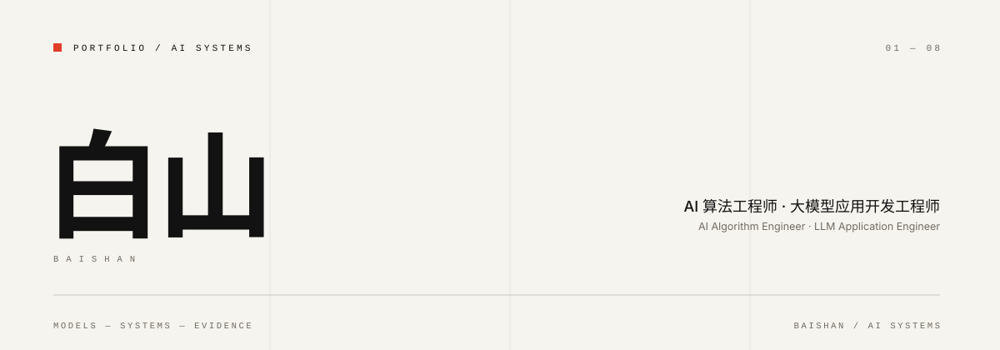
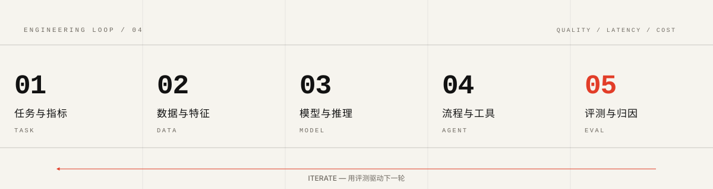
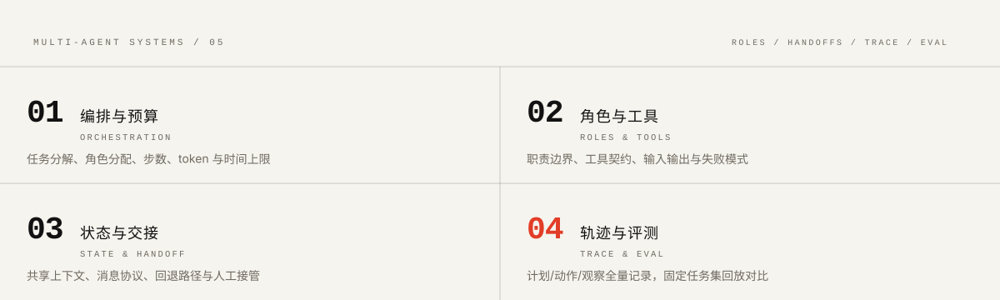

<picture>
  <source media="(prefers-color-scheme: dark)" srcset="assets/hero-dark.svg">
  <source media="(prefers-color-scheme: light)" srcset="assets/hero-light.svg">
  
</picture>

**我把 AI 应用当作可测量的系统：先定义失败，再谈效果。**  
I treat AI applications as measurable systems: define failure first, then talk about performance.

[Email](mailto:baishanmumu@gmail.com) · [Repositories](https://github.com/baishanmumu?tab=repositories) · [AgentLens 构想](projects/agentlens/README.md)

<picture>
  <source media="(prefers-color-scheme: dark)" srcset="assets/sections/01-profile-dark.svg">
  <source media="(prefers-color-scheme: light)" srcset="assets/sections/01-profile-light.svg">
  
</picture>

**中文** — 我做 AI 算法与大模型应用。大部分时间，我在处理同一个矛盾：模型是概率性的，工程要求是确定性的。

**问题先于模型。** 很多 LLM 项目卡住，不是因为模型不够强，而是任务没有被定义成可判定的问题：输入边界含糊、成功标准靠感觉、失败无法归因。同一条错误答案，可能来自没召回、召回错、上下文太长、工具参数错，或者模型没按格式输出；不拆开看，就不知道该改哪一层。我的习惯是先把任务拆成明确的输入、输出和成功条件，再决定用一次模型调用、RAG、微调，还是多步 Agent。能一次调用解决的，不加工作流；能一个 Agent 解决的，不加第二个。

**评测不是最后一步。** 我目前最关心 Agent 的评测与调试：不是看最终答案像不像，而是把一次运行拆成计划、工具调用、观察和结论，定位它从哪一步开始偏。AgentLens 是这个方向上的方案尝试。

**English** — I work on AI algorithms and LLM applications. Most of the time I am dealing with the same tension: models are probabilistic, while engineering requirements are deterministic.

**The problem comes before the model.** Most LLM projects get stuck for reasons other than model capability: the task is not defined as something that can be judged. The same wrong answer can come from a missed retrieval, a bad chunk, an overlong context, a malformed tool argument, or a model that ignored the output format. Without separating those, there is no way to know which layer to fix. I start by turning the task into explicit inputs, outputs and success criteria, then choose between a single call, RAG, fine-tuning or a multi-step agent. If one call is enough, I don't add a workflow; if one agent is enough, I don't add a second.

**Evaluation is not the last step.** My current focus is agent evaluation and debugging: not whether the final answer looks right, but whether a run can be broken into plan, tool calls, observations and conclusions, and where it started to drift. AgentLens is my attempt to make that concrete.

<picture>
  <source media="(prefers-color-scheme: dark)" srcset="assets/sections/02-focus-dark.svg">
  <source media="(prefers-color-scheme: light)" srcset="assets/sections/02-focus-light.svg">
  
</picture>

- **任务与指标 / TASK & METRIC** — 先把“错”定义清楚。成功条件不可判定时，换模型只是换一种随机。
- **检索与上下文 / RETRIEVAL & CONTEXT** — 很多“模型答错”是材料没进来。先看召回、切分和上下文预算，再调提示词。
- **工具与编排 / TOOLS & ORCHESTRATION** — 工具契约、参数校验和停止条件，比多写两轮提示词更决定 Agent 的稳定性。
- **评测与归因 / EVAL & ATTRIBUTION** — 把运行变成可回放轨迹，用固定任务集做对照。没有对照的“变好了”不算结论。

<picture>
  <source media="(prefers-color-scheme: dark)" srcset="assets/sections/03-stack-dark.svg">
  <source media="(prefers-color-scheme: light)" srcset="assets/sections/03-stack-light.svg">
  
</picture>

工具不是身份。下面这些是我用来把系统做出来、量出来、盯住的。  
Tools are not an identity. These are what I use to build, measure and monitor systems.

          
          
        

点击徽章前往对应技术的官网或官方文档 · Click a badge for the official site or docs

<picture>
  <source media="(prefers-color-scheme: dark)" srcset="assets/sections/04-how-i-build-dark.svg">
  <source media="(prefers-color-scheme: light)" srcset="assets/sections/04-how-i-build-light.svg">
  
</picture>

<picture>
  <source media="(prefers-color-scheme: dark)" srcset="assets/loop-dark.svg">
  <source media="(prefers-color-scheme: light)" srcset="assets/loop-light.svg">
  
</picture>

**中文** — 遇到效果问题，我按这个顺序排查：任务定义与评测集、检索与上下文、工具契约与参数、模型与提示、编排方式。越靠前的问题，越不应该用换模型解决。如果检索根本没召回，换模型只是把错误答案换得更流畅。

每次改动都当成一次实验：固定任务集、固定工具替身，记录延迟与 token 成本，再看任务完成度、答案依据和失败类型有没有变化。没有对照的“感觉变好了”，通常只是换了一种错法。

**English** — When an LLM system underperforms, I debug in this order: task definition and evaluation set, retrieval and context, tool contracts and arguments, model and prompt, then orchestration. The earlier a problem sits in that list, the less sense it makes to solve it by switching models. If retrieval never surfaced the evidence, a better model only produces a smoother wrong answer.

I treat every change as an experiment: fixed task set, fixed tool doubles, latency and token cost recorded, then compare task success, grounding and failure types. A change that feels better without a control is usually just a different failure.

<picture>
  <source media="(prefers-color-scheme: dark)" srcset="assets/sections/05-multi-agent-dark.svg">
  <source media="(prefers-color-scheme: light)" srcset="assets/sections/05-multi-agent-light.svg">
  
</picture>

**多智能体首先是一个组织设计问题，其次才是提示词问题。**

Multi-agent is an organizational design problem before it is a prompting problem.

<picture>
  <source media="(prefers-color-scheme: dark)" srcset="assets/topology-dark.svg">
  <source media="(prefers-color-scheme: light)" srcset="assets/topology-light.svg">
  
</picture>

**中文** — 我不相信“让几个 Agent 互相讨论就能变聪明”。多智能体只在三种情况下值得：任务可以真正并行、子任务需要不同工具与上下文、或者需要一个独立角色做交叉验证。其余场景往往只是把本可串行完成的步骤拆成并行，再花更多时间合并状态，顺带多付 token 和延迟。

真正难的是交接：谁决定下一步、什么状态允许交接、交接时传什么、失败由谁负责。交接时如果只传结论、不传证据，下一个 Agent 只能重新猜。supervisor、handoff、debate、blackboard 只是四种组织方式，选哪种取决于任务可分解性和失败代价。我的做法是先把角色、工具、状态和评测四个面定清楚，再写编排；一条轨迹如果无法回放，这个多智能体系统就不算可调试。

**English** — I don't buy the idea that letting several agents debate each other makes them smarter. Multi-agent pays off in three cases: the work is genuinely parallel, subtasks need different tools and context, or an independent role is needed for cross-checking. In most other cases it turns work that could run sequentially into parallel branches, then spends the savings merging state, with extra tokens and latency.

The hard part is handoff: who decides the next step, which states allow a handoff, what gets passed, and who owns a failure. If a handoff passes only a conclusion and not the evidence, the next agent can only guess. Supervisor, handoff, debate and blackboard are just four organizational shapes; the choice depends on decomposability and the cost of failure. I define roles, tools, state and evaluation before writing orchestration. If a run cannot be replayed, the system is not debuggable.

<picture>
  <source media="(prefers-color-scheme: dark)" srcset="assets/sections/06-agentlens-dark.svg">
  <source media="(prefers-color-scheme: light)" srcset="assets/sections/06-agentlens-light.svg">
  
</picture>

**AgentLens** — 不是再做一个 Agent 框架，而是想把 Agent 的失败变成可查的调用链。

现有评测大多只看最终答案，但 Agent 的失败常发生在中间步骤：工具选错、参数错、观察被忽略、循环停不下来。AgentLens 的设想是把运行记录成可回放的轨迹，用固定任务集和工具替身复现，再比较 prompt、模型或编排变化对任务完成、工具选择、参数正确性、依据、延迟和 token 成本的影响。

**English** — AgentLens is not another agent framework. It is an attempt to make agent failures inspectable as a call chain. Most evaluations only look at the final answer, while agent failures usually happen in the middle: the wrong tool, a bad argument, an ignored observation, a loop that never stops. The idea is to record each run as a replayable trace, reproduce it with fixed tasks and tool doubles, and compare how prompt, model or orchestration changes affect task success, tool choice, argument correctness, grounding, latency and token cost.

> **Status — concept stage.** 方案阶段，没有实现，也没有 benchmark 数字可以宣称。  
> No implementation, no benchmark numbers.

[Read the blueprint →](projects/agentlens/README.md)

<picture>
  <source media="(prefers-color-scheme: dark)" srcset="assets/sections/07-contact-dark.svg">
  <source media="(prefers-color-scheme: light)" srcset="assets/sections/07-contact-light.svg">
  
</picture>

如果你正在做 Agent 评测、RAG 可靠性或多智能体编排，欢迎带着具体问题来聊。比起“合作”，我更想听失败案例。  
If you work on agent evaluation, RAG reliability or multi-agent orchestration, bring a concrete problem. I would rather hear about a failure than a generic collaboration pitch.

[baishanmumu@gmail.com](mailto:baishanmumu@gmail.com)

BAISHAN / AI SYSTEMS
