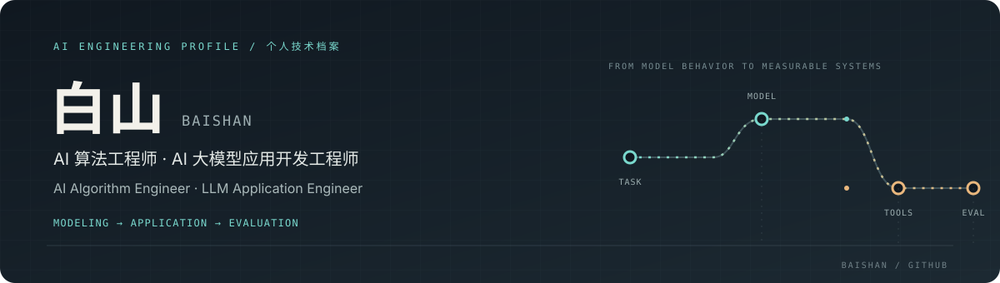

<p align="center">
  
</p>

<p align="center">
  <strong>算法工程师 · AI 大模型应用开发</strong><br />
  把模型能力转化为可评估、可交付的工程系统。
</p>

<p align="center">
  <a href="mailto:yizhimilu1017@163.com">Email</a> ·
  <a href="https://github.com/baishanmumu?tab=repositories">Repositories</a>
</p>

---

### Focus

| Algorithms & Search | LLM Applications | Agent Systems | Evaluation & Reliability |
| :--- | :--- | :--- | :--- |
| 问题建模、搜索与决策 | 将模型接入真实任务流程 | Agent 编排、工具调用与状态管理 | 让效果可观测、可复现、可迭代 |

### In Design · AgentLens

**A reproducible evaluation and debugging workbench for tool-using agents.**

The idea: capture each agent run, replay it against a fixed task set, and compare where a prompt or model change affects task success, tool use, latency, and token cost.

> **Status: Concept stage.** This is a proposed personal project; implementation and results will be added as they are built.

[Read the project blueprint](projects/agentlens/README.md)

### Open-source References

These repositories are forks I keep as technical references. Each link makes the upstream ownership explicit.

| Project | What it explores | Source |
| :--- | :--- | :--- |
| **ARTEX** | Agent-driven security testing, approval workflows, and asset exploration | [Upstream](https://github.com/archiveproject/ARTEX) · [My fork](https://github.com/baishanmumu/ARTEX) |
| **Cairn** | State-space search for autonomous security testing | [Upstream](https://github.com/oritera/Cairn) · [My fork](https://github.com/baishanmumu/Cairn) |
| **Hermes Agent** | A general-purpose assistant agent and its tool ecosystem | [Upstream](https://github.com/NousResearch/hermes-agent) · [My fork](https://github.com/baishanmumu/hermes-agent) |
| **REA** | Agent-assisted reverse engineering, from application behavior to native binaries | [Upstream](https://github.com/morluto/rea) · [My fork](https://github.com/baishanmumu/rea) |

### Engineering Approach

```text
Problem framing → Model & algorithm → Tools and data → Evaluation → Iteration
```

I care about the full path from a model capability to a dependable workflow: clear task boundaries, observable intermediate steps, and evaluation that can guide the next change.

### Contact

For conversations about algorithms, LLM applications, or agent systems, reach me at [yizhimilu1017@163.com](mailto:yizhimilu1017@163.com).
